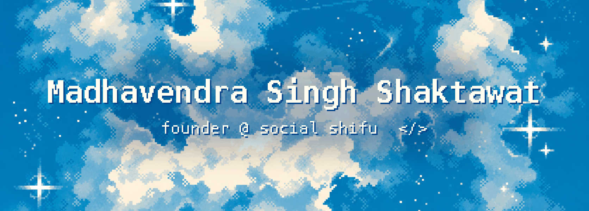

  

  
  
  
  
  

<h2 align="center">About me</h2>

Hi, I'm **Madhavendra**, founder of [**Social Shifu**](https://socialshifu.com). I build AI products end to end: the model pipelines, the backend, and the apps people actually open every day, on the web, iOS and Android.

Right now I'm shipping three products under Social Shifu, and most of what I write goes into them.

  Founder at Social Shifu 
  Building ShifuCut, Solo Leveling System and DripCheck 
  Shipping across web, iOS and Android

 

<h2 align="center">Products</h2>

| Product | What it does |
| :-- | :-- |
| [**ShifuCut**](https://www.shifucut.ai) | AI video editor for iPhone. Talk to camera and it cuts retakes, umms and dead air, keeps your best take, and adds captions. |
| [**Solo Leveling System**](https://www.sololevelingsystem.com) | Gamified habit tracker that turns your life into an RPG, with AI quests, XP and rank progression from F to S. |
| [**DripCheck**](https://www.dripcheck.fit) | Virtual wardrobe and outfit planner that keeps your closet organised and helps you decide what to wear. |

<h2 align="center">Technologies</h2>

<table>
  <tr>
    <td><b>Languages</b></td>
    <td>
      
      
      
      
      
    </td>
  </tr>
  <tr>
    <td><b>Frontend</b></td>
    <td>
      
      
      
      
    </td>
  </tr>
  <tr>
    <td><b>Motion &amp; 3D</b></td>
    <td>
      
      
      
    </td>
  </tr>
  <tr>
    <td><b>Mobile</b></td>
    <td>
      
      
      
      
    </td>
  </tr>
  <tr>
    <td><b>Backend</b></td>
    <td>
      
      
      
    </td>
  </tr>
  <tr>
    <td><b>Data</b></td>
    <td>
      
      
      
      
    </td>
  </tr>
  <tr>
    <td><b>AI</b></td>
    <td>
      
      
      
    </td>
  </tr>
  <tr>
    <td><b>Infra</b></td>
    <td>
      
      
      
    </td>
  </tr>
  <tr>
    <td><b>Monitoring</b></td>
    <td>
      
      
    </td>
  </tr>
</table>

<h2 align="center">Statistics</h2>

  
  

  

